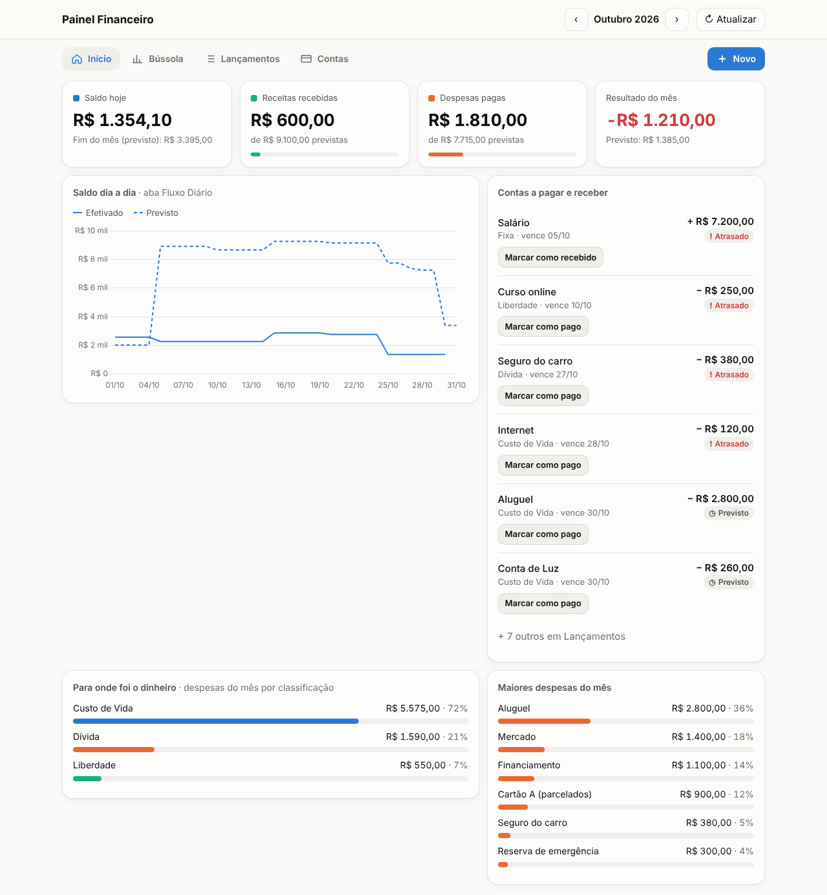
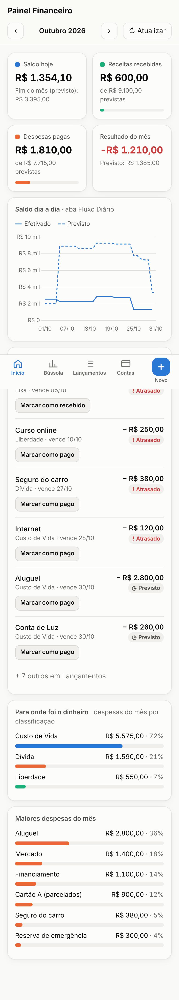
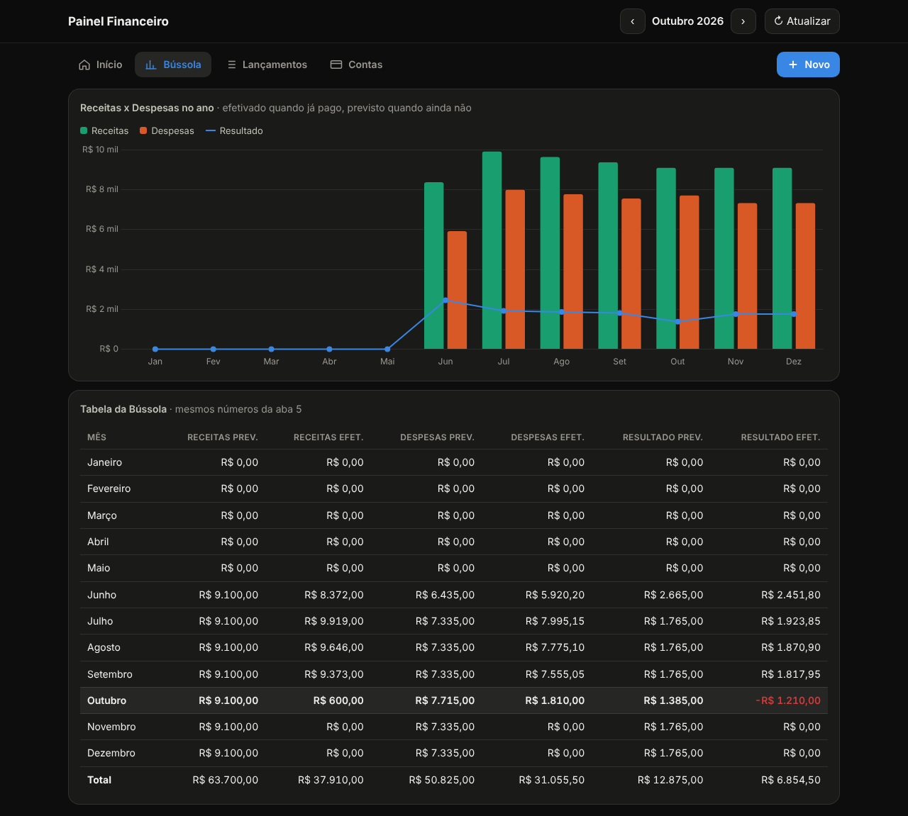

# 💰 Painel Financeiro (para a planilha SGL)

Um painel visual da sua vida financeira que **lê e grava direto na sua planilha
Google "SGL"**. Abre no computador, no tablet e no celular pelo mesmo link.

```
 Computador ─┐
 Tablet ─────┼──►  Painel (este código)  ──►  Planilha SGL (continua sendo o "banco de dados")
 Celular ────┘     roda grátis no Google
```

- Não precisa instalar nada no computador.
- Não precisa de servidor nem de cartão de crédito.
- Só você acessa (o link pede o seu login Google).
- As fórmulas da planilha continuam funcionando: o painel só preenche as
  colunas que você já preenchia à mão (as com ⌨️ e a DATA EFETIVADA).

| Computador | Celular | Bússola (modo escuro) |
|---|---|---|
|  |  |  |

<sub>Capturas com dados fictícios.</sub>

---

## O que tem no painel

| Tela | Para que serve |
|---|---|
| **Início** | Saldo de hoje, receitas e despesas do mês (efetivado x previsto), gráfico do saldo dia a dia, contas atrasadas e a vencer nos próximos 15 dias, para onde foi o dinheiro |
| **Bússola** | Gráfico do ano (receitas x despesas x resultado) + a mesma tabela da aba 5. Clique numa barra para ir àquele mês |
| **Lançamentos** | Lista do mês com filtros (despesas/receitas, a pagar/pagos, busca). Botão **Marcar como pago** |
| **Contas** | Parcelas de cartão por mês (aba "Apoio parcelados"), quanto ainda falta pagar por cartão e as contas cadastradas |
| **+ Novo** | Formulário para lançar uma despesa ou receita, com opção de repetir por vários meses |

As setas **‹ ›** no topo trocam o mês exibido. O botão **↻ Atualizar** busca
os dados mais recentes, caso você tenha mexido na planilha por fora.

---

## Instalação (uns 10 minutos, uma vez só)

> 🛟 **Primeiro, teste numa cópia.** Na planilha: *Arquivo → Fazer uma cópia*.
> Faça os passos abaixo na cópia. Quando estiver tudo certo, repita na original.

### Passo 1 — Abrir o editor de código da planilha
Na planilha, menu **Extensões → Apps Script**. Abre uma aba nova com um
arquivo chamado `Código.gs` (ou `Code.gs`).

### Passo 2 — Colar o servidor
Apague tudo que estiver em `Código.gs` e cole o conteúdo do arquivo
[`Code.gs`](Code.gs) deste repositório. Clique no disquete 💾 para salvar.

### Passo 3 — Criar os 3 arquivos de tela
Para cada um dos arquivos abaixo:
1. Clique no **+** ao lado de "Arquivos" → **HTML**.
2. Digite o nome **exatamente** como está (sem o `.html`, o Google põe sozinho).
3. Apague o conteúdo que vem pronto e cole o do arquivo correspondente.

| Nome no Apps Script | Copie de |
|---|---|
| `Index` | [`Index.html`](Index.html) |
| `Styles` | [`Styles.html`](Styles.html) |
| `App` | [`App.html`](App.html) |

Salve 💾. A lista de arquivos à esquerda deve ficar assim:

```
Arquivos
 ├─ Código.gs
 ├─ App.html
 ├─ Index.html
 └─ Styles.html
```

### Passo 4 — Publicar como app da Web
1. Botão azul **Implantar → Nova implantação**.
2. Na engrenagem ⚙️ ao lado de "Selecionar tipo", escolha **App da Web**.
3. Preencha:
   - **Descrição:** Painel financeiro
   - **Executar como:** *Eu* (seu e-mail)
   - **Quem pode acessar:** *Somente eu*
4. Clique em **Implantar**.
5. O Google vai pedir **autorização** (é o seu próprio código pedindo para
   ler/gravar a sua planilha). Clique em *Autorizar acesso*, escolha sua conta.
   Se aparecer "O Google não verificou este app", clique em **Avançado →
   Acessar (não seguro)**. Isso aparece para todo script pessoal que não foi
   publicado na loja do Google — o código é o deste repositório.
6. Copie o **URL do app da Web** (termina em `/exec`). Esse é o seu painel! 🎉

### Passo 5 — Colocar no celular e no tablet
Abra o link `/exec` no navegador do aparelho (logada na mesma conta Google):

- **iPhone/iPad (Safari):** botão Compartilhar ⬆️ → **Adicionar à Tela de Início**.
- **Android (Chrome):** menu ⋮ → **Adicionar à tela inicial**.

Vira um ícone, igual a um aplicativo.

---

## Como atualizar o código depois

Quando houver uma versão nova dos arquivos: cole as mudanças no editor e vá em
**Implantar → Gerenciar implantações → ✏️ (editar) → Versão: Nova versão →
Implantar**. O link continua o mesmo.

---

## Como funciona por dentro (para aprender)

```
┌────────────────────── no seu navegador ──────────────────────┐
│ Index.html  → o "esqueleto": topo, menu, as 5 telas          │
│ Styles.html → a "roupa": cores, tamanhos, modo escuro,       │
│               layout que vira 1 coluna no celular            │
│ App.html    → o "cérebro": pede os dados, soma o mês,        │
│               desenha os gráficos (biblioteca Chart.js)      │
└──────────────┬───────────────────────────────▲───────────────┘
               │ google.script.run.getDados()  │ dados prontos
               ▼                               │
┌────────────────────── no Google ────────────────────────────┐
│ Code.gs → o "garçom": lê as abas e grava lançamentos/baixas │
└──────────────┬──────────────────────────────────────────────┘
               ▼
        Planilha SGL - 2026
```

**De onde vem cada número:**

| No painel | Na planilha |
|---|---|
| Receitas/Despesas previstas | Soma de VALOR PREVISTO das abas 2 e 3 no mês do vencimento (igual à Bússola) |
| Receitas recebidas / Despesas pagas | Soma de VALOR EFETIVADO |
| "Movimento Interno" | Fica fora das somas, igual à Bússola |
| Saldo hoje / gráfico de saldo | Colunas SALDO FINAL (E) e (P) da aba 4 |
| Atrasado | Situação PREVISTO com vencimento antes de hoje |
| Parcelas de cartão | Aba "Apoio parcelados" |

**O que acontece quando você usa os botões:**

- **+ Novo → Salvar:** escreve Descrição, Classificação/Tipo, Valor Previsto e
  Vencimento na primeira linha livre (logo abaixo do último lançamento). Com
  "Repetir 12", cria 12 linhas, uma por mês. Se a linha ainda não tiver as
  fórmulas de Mês/Situação/Resultado/Período, o painel copia da linha de cima.
- **Marcar como pago:** preenche VALOR EFETIVADO e DATA EFETIVADA. A coluna
  SITUAÇÃO vira EFETIVADO sozinha (é a fórmula da planilha). Antes de gravar, o
  painel confere se a descrição da linha ainda é a mesma, para nunca gravar na
  linha errada.

---

## Problemas comuns

| Mensagem | O que fazer |
|---|---|
| `Não encontrei a aba "..."` | Você renomeou uma aba. Ajuste o nome no topo do `Code.gs` (bloco `ABAS`) |
| `Não encontrei a coluna "..."` | O cabeçalho da linha 1 de Receitas/Despesas mudou. Volte o nome original |
| `A planilha mudou desde que o painel foi aberto` | Clique em **↻ Atualizar** e tente de novo |
| Gráficos não aparecem | Recarregue a página; a biblioteca de gráficos vem da internet |
| Mudei o código e nada mudou | Faltou criar uma **Nova versão** na implantação (veja "Como atualizar") |

---

## Ideias para as próximas versões

- 🎯 Metas por classificação (ex.: "Liberdade ≥ 10% da renda") com barra de progresso.
- 📧 E-mail automático toda manhã com as contas que vencem no dia (gatilho diário do Apps Script).
- 🏦 Saldo por conta (precisaria de uma coluna "Conta" nas abas de Receitas e Despesas).
- 📥 Importar extrato do banco (CSV) e sugerir a classificação.
